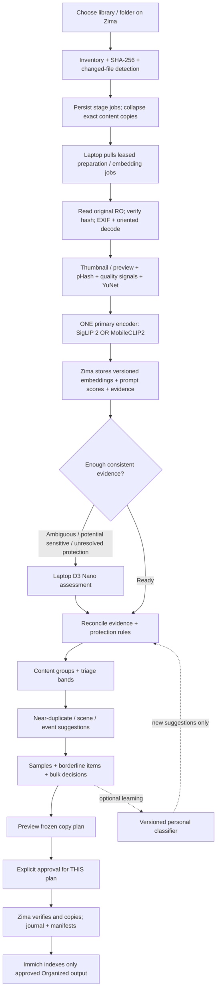

# 02 · Canonical processing pipeline

Status: canonical contract; inventory/review, preparation, comparison infrastructure and verified
export are implemented. Leased image embedding, prompt encoding, labelled comparison, explicit promotion and bounded scoring run; they are measured only on generated images (HANDOFF section 11). The real-library comparison and D3 remain pending. Updated 1 November 2026.
See [backend guide](../server/README.md) for tested capabilities and later-phase boundaries.
This is the processing contract for the fresh PhotoSift project. It supersedes conflicting pipeline examples in the early research notes. Architecture: [01](01-architecture.md). Model contracts: [03](03-models.md). Review/export: [04](04-review-and-export.md).

## End-to-end flow



No stage deletes or changes an original. Source access is read-only on both machines. “Free signals” means no neural inference, not zero CPU/IO cost.

## Machine responsibilities

| Zima, durable owner | GPU laptop, replaceable executor |
|---|---|
| Source scope, file inventory, throttled SHA-256 | Full image decode and EXIF extraction for analysis |
| SQLite WAL, leases, jobs, results, decisions | Oriented thumbnails/previews, pHash and quality signals |
| Prompt scoring over stored vectors, indexes | YuNet face detection; explicit missing/error states |
| Protection policies, groups, event metadata | SigLIP 2 OR MobileCLIP2 image/text encoder |
| UI, bulk actions, copy planning and export | D3 Nano through explicitly configured local runtime |

Initial bulk preprocessing belongs on the laptop. Zima does not also decode every original for blur/pHash/previews. Its scan reads file entries/stat and streams source bytes for hashing; hashing a huge library is IO work and must be throttled and resumable. Cached images returned by the laptop are stored on Zima, so browsing survives laptop shutdown.

A small CPU preparation/embedding executor on Zima is optional, separately benchmarked and explicitly enabled. It is not an implicit fallback.

## 0. Setup and measured model selection

- Register source roots as IDs and configure read-only path mappings on each host. A Windows worker maps a root ID to a read-only SMB path; it does not execute arbitrary server-supplied absolute paths.
- Select one primary embedding checkpoint after comparing SigLIP 2 and MobileCLIP2 on the same labelled sample. Keep evaluation indexes separate.
- Record model revision, preprocessing, dimension, dtype/precision, normalization and runtime in a reproducible fingerprint.
- Register D3 Nano's model tag, endpoint, adapter and question/schema version together. Prior integration used Ollama `/v1/systemone`; validate that exact request/response contract for this fresh adapter. Do not infer `/api/chat` compatibility.
- Begin with existing labels or a small stratified sample; expand it through corrections. No fixed number of labels guarantees quality.
- Enable protected folders and conservative unknown/error handling before making Clutter suggestions visible.

**Saved:** source mappings, model registry, active index, prompt/policy versions, benchmark results. No inference job starts simply because the gallery is opened.

## 1. Inventory and content identity — Zima

1. Freeze the requested root/folder subtree boundary for the scan.
2. Walk without following source symlinks; record path, size, mtime and status.
3. Stream SHA-256 for new/changed files. A fast non-cryptographic hash may be a prefilter but is not the final identity or copy-verification hash.
4. Maintain separate file instances and unique content records. Multiple paths with identical content share analysis; their paths remain visible.
5. Queue missing preparation/model stages for each supported unique content.
6. Mark unseen paths missing only after a complete reachable scan; preserve historical records.

Changed content at the same path becomes a new content version. Size/mtime is an incremental optimization, not an absolute proof against undetectable source edits; provide an explicit verification rescan mode.

**Saved:** file instances, content hash/size, scan run and eligibility. Unsupported or unreadable files are inventoried and shown explicitly, not silently counted as analyzed.

## 2. Durable dispatch and leases — Zima ↔ laptop

The laptop agent **pulls** compatible jobs from Zima. Zima owns the queue; no Postgres `SKIP LOCKED` or Redis is required for this SQLite design.

Each claim contains:

- Job ID, stage, content hash, source root ID and relative path.
- Expected source size/version and exact requested model/preparation fingerprint.
- Attempt ID, random claim token, owner and expiry.

Claim with a short SQLite transaction; never hold the transaction during IO or inference. The agent renews its lease while working. Its pull loop invokes local model runtimes; Zima does not require an inbound laptop inference endpoint for background work.

Submit and acknowledge **per image/stage**, not only at the end of a batch. Validate token/expiry, stage fingerprint, source hash and payload shape. An expired claim or superseded input cannot overwrite newer work. Duplicate submission of the same accepted stage result returns its previous acknowledgement.

**Saved:** queued → running → done; retry-wait, paused/unavailable, failed or skipped with reason. Lease expiry makes unfinished claims eligible again. Completed stages are not repeated after laptop shutdown.

## 3. Prepare, inspect quality and detect faces — laptop

Read a mapped original through a read-only handle, verify expected content and check for changes. Reject mismatches and request an inventory refresh.

Produce:

- EXIF/camera/capture-date/GPS metadata with provenance.
- Oriented first-frame image for supported formats.
- Small WebP thumbnail and an aspect-preserving assessment preview.
- pHash/dHash, dimensions, exposure/clipping and blur signals.
- YuNet face detections with detector version/threshold/status.

Do not confuse a face detector with people recognition or personal importance. No face detected does not mean no person or no valuable memory. A failed/not-run detector is Unknown, not No faces. Quality scores alone do not establish junk.

Upload cache artifacts with bounded sizes, content-associated ownership and atomic publication. Zima validates formats and stores them under content/preparation-version keys.

**Saved:** preparation result, metadata, cache references, quality/face evidence. Metadata/quality/faces can share one decode within an execution; restarting or running another stage may require a new read.

## 4. Primary embedding — laptop GPU

Run **SigLIP 2 OR MobileCLIP2**, whichever index is explicitly primary. Do not run both over the full library by default.

- Apply the checkpoint's exact image preprocessing; an arbitrary UI thumbnail is not a substitute.
- Store normalized image vectors with the full index fingerprint.
- Encode category prompt packs using the matching text encoder.
- On Zima, compare image vectors with prompt vectors and store candidate scores, competing classes and margins. Include ordinary personal photos/hard negatives, not only junk prompts.
- Store scoring provenance and thresholds per index AND prompt-pack/policy version.

Scores and margins are ranking signals until calibrated on this library; they are not probabilities of junk. Content classification is separate from a user's Keep/Clutter preference.

GPU scheduling is bounded. On an 8 GB laptop, stage embedding and D3 work if concurrent model loading exceeds measured memory; do not assume all models can remain resident.

**Saved:** vector, index ID, candidate content/subcategory scores and scoring revision.

## 5. Escalation assessment — D3 Nano on laptop

Escalate when evidence is ambiguous, conflicting, potentially sensitive, or insufficient to resolve a protection check. A user may also explicitly request assessment.

There is no assumed 5–15% escalation rate. Measure how many items this policy sends to D3, including the effect of document/people protection rules.

The adapter validates supported structured fields for content type, people/text, potential importance and sensitivity where available. Unknown fields or unsupported tasks remain Unknown; do not invent a free-text explanation or a sensitive flag from a schema that does not supply them. Score-derived reasons must identify themselves as such.

Keep **importance** and **sensitivity** separate. An important family memory remains Personal/Keep-worthy, not automatically Sensitive. IDs/financial/medical candidates may need restricted review regardless of their content group.

**Saved:** raw bounded response, parsed assessment, model/protocol/question/schema versions, duration and error/status. Model unavailable pauses this stage; no silent model switching.

## 6. Evidence reconciliation and protection gate — Zima

Maintain independent axes:

| Axis | Examples |
|---|---|
| Estimated origin | Camera, Screenshot, Shared/forwarded, Downloaded, Edited, Unknown |
| Content | Personal/people, Food, Place, Document, Meme/graphic, Screenshot UI, Object, Other, Unclassified |
| Importance | Yes / No / Unknown, evidence and source |
| Sensitivity | Yes / No / Unknown, evidence and source |
| Triage suggestion | Likely Keep, Clutter candidate, Needs review, Awaiting analysis |
| User decision | Undecided, Keep, Clutter, Review later |

Missing EXIF and a WhatsApp filename are weak origin clues, not proof that a photo is disposable. Shared personal photos can belong to events. Preserve Unknown and conflicting evidence.

Apply protections **before publishing a Clutter candidate**:

- Explicit protected folder or existing manual Keep.
- People/face evidence, subject to an explicit conservative policy.
- Potentially important/sensitive or unresolved required checks.
- User-configured date/age protection where a sufficiently reliable date exists.

A protected image stays in its useful content group with a protection badge. Only sensitivity places it in restricted handling. Unknown prerequisites hold it for review rather than being interpreted as safe to discard.

A strong junk score plus margin may create a candidate only after this gate. Nothing here writes a final user decision. Manual corrections override suggestions and trigger deterministic regrouping without rerunning image models unnecessarily.

**Saved:** content/group assignment, evidence references, policy revision, protection reasons and triage band.

## 7. Similarity, duplicate and event suggestions — Zima

- **Exact copies:** SHA-256 identity, one content with many paths. Export can choose one verified source without labelling the entire content Clutter.
- **Near-duplicates/bursts:** pHash + same-index visual similarity + appropriate time/context. Show “possible match”; do not preselect distinct visual images for Clutter. Suggest a keeper with measured quality reasons, not aesthetic certainty.
- **Scenes/events:** capture-time proximity plus visual/GPS evidence. Use trusted EXIF, then filename/folder date, then labelled uncertain file time. Camera origin is evidence, not an eligibility requirement; shared personal photos can be included.
- **Trips:** optional GPS-based suggestions; missing GPS or metadata does not exclude an image. No trip/home inference is treated as fact without review.
- **Semantic search:** text encoder and image vectors must use the same index. Example-image similarity can use already stored vectors while the laptop is offline; a new text query still needs its matching text encoder or a cached query vector.

Begin with deterministic time/neighbor grouping. Theme clustering, complex trip inference and album naming are later additions, not prerequisites for decluttering.

**Saved:** versioned suggested group memberships/reasons, separate from source files and user-confirmed album edits. Avoid materializing a full N×N similarity matrix for a large library.

## 8. Group-first review and learning — Zima UI

Use Library → Analyze → Sort & Review → Export.

Group cards show **All / Undecided / Decided**, a representative/stratified sample, borderline items and protection counts. Include Personal, Documents, Food, Memes/graphics, Screenshots, Other, Unclassified and useful similarity/event views. Sensitivity is a restricted filter/subgroup, not a synonym for importance.

One bulk action may cover thousands of photos. Offer Select page, Select all matching, explicit exclusions and individual correction. Samples help inspection; they are not proof that every member is correct.

Every selection belongs to a loaded query/scope revision. Disable stale-page selection during filter transitions. Freeze IDs, selection fingerprint and relevant review/policy revisions at confirmation; validate before applying. Never silently broaden root/folder scope. Long bulk actions use durable, idempotent jobs with explicit applied/conflict counts and restart recovery; conflicting newer decisions are not overwritten silently.

Keep an audit record for each changed content and action-level scope. Make undo/reversal version-aware so it does not erase later edits. Keyboard actions require a loaded visible matching image. Preserve filters/page/detail through Back/reload; focus stays within accessible dialogs.

Optional personal classifier: train on primary-index vectors and user-approved labels after enough diverse examples exist. Separate content labels from preference labels. Validate with held-out events/similarity groups and report false-Clutter errors on personal photos, not accuracy alone. Retraining creates versioned suggestions, never overwrites user decisions. Improvement is measured, not guaranteed.

## 9. Frozen export and later gallery indexing — Zima

Create a copy-only plan from explicitly chosen reviewed scope. Show output mapping, selected decisions, bytes, available space and exclusions. Sensitivity/review-later/Clutter handling is explicit; do not silently include them in a shared gallery root.

Plan entries freeze source instance/hash/size, destination, decision/category/group snapshots, provenance and collision handling. Approval is tied to the exact displayed plan ID/revision and state; typed text cannot carry across another plan through history.

The exporter verifies sources, copies to temporary outputs, verifies content and publishes without overwrite. Record output ownership/identity and every operation. Write manifests atomically. Retry/rollback is explicit and recoverable; rollback removes only unchanged verified outputs created by that run.

**No hardlinks to originals:** editing a writable alias could change the original's underlying content. Use independent verified copies; consider filesystem copy-on-write cloning only as a separately verified optimization later.

```text
PhotoSift-<run-id>/
  Organized/                 # intended gallery scope
    Photos/<Year>/<Event-or-Month>/
    Documents/<subgroup>/
    Food/                    # reviewed food-only content, explicit mapping
    Screenshots/             # only reviewed Keep items
    Memes-and-Graphics/       # only reviewed Keep items
  Private/Sensitive/         # optional explicit export, outside Organized
  Review-Later/              # optional, outside Organized
  Clutter/<bucket>/          # optional set-aside copy, outside Organized
  manifest.csv
  manifest.json
```

Immich can index `Organized/` as a read-only external library. Keep Private/Clutter outside that mount scope. Immich API album creation and XMP sidecars on exported copies are optional later features; never write sidecars into source folders.

## Recovery and incremental behavior

| Situation | Required outcome |
|---|---|
| Laptop asleep/offline | Existing groups/review/cache remain; unfinished claims expire and requeue |
| Source disconnected | Pause affected work; no mass missing reconciliation |
| Source changes after queueing | Reject stale hash/version; rescan, do not attach results to replacement bytes |
| Model missing/OOM/offline | Explicit stage error/pause; keep prior results; no automatic model substitution |
| Crash after some results | Accepted per-image stages remain done; idempotent retries |
| New prompt pack | Rescore stored vectors; do not re-embed unless image encoder/preprocessing changes |
| New embedding model | New separate index → backfill → explicit promotion; preserve manual decisions |
| Stale filter/page/result | Discard outdated UI response; do not enable actions against old content |
| Conflicting manual edit | Report conflict; no silent overwrite or expanded selection |
| Export interrupted | Resume journaled operations; never overwrite ambiguous unjournaled output |

## Implementation sequence and gates

1. **Foundation/protection:** SQLite schema, roots, read-only inventory, worker claims, protected folders, explicit Unknown, versioned bulk/export scope contracts.
2. **Preparation + browse:** laptop mapped reads, hash checks, EXIF/cache/quality/pHash and YuNet; Zima grid/metadata; offline recovery.
3. **Embedding comparison:** benchmark SigLIP 2 and MobileCLIP2, choose primary, store vectors and prompt evidence. No performance promises before measurement.
4. **D3 + triage:** test actual decision protocol, reconcile evidence, apply protection gate; no automatic final Clutter decisions.
5. **Bulk cleanup:** compact groups/samples/borderline views, frozen cross-page selection/exclusions, corrections/history/recovery; test 50k generated metadata actions.
6. **Similarity + events:** conservative candidate groups, date provenance, searchable vectors and editable event suggestions.
7. **Verified export:** plan-bound approval, capacity/overlap/collision checks, identity/hash verification and rollback tests.
8. **Learning and integrations:** optional calibrated preference model, advanced albums, Immich API/XMP, benchmarked CPU executor.

Test each phase before building the next. Measure preparation, GPU work, grouping/search, bulk writes, browser behavior and copy IO separately. No percentage of escalations, perfect protection, seconds-level retraining or 50k performance is guaranteed by this design.
